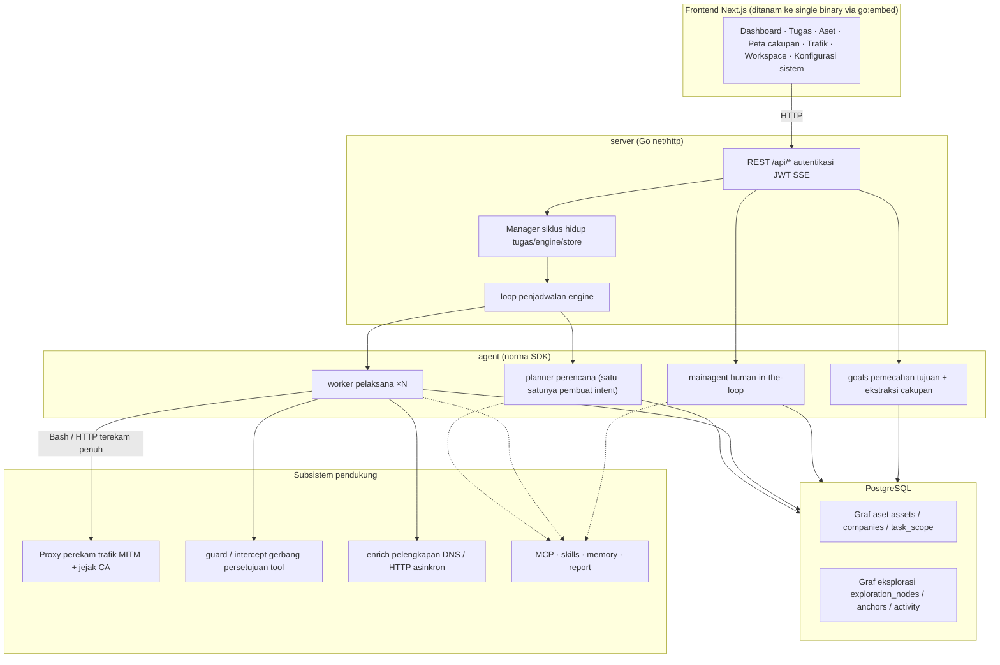
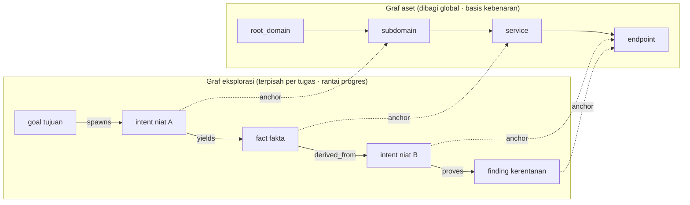
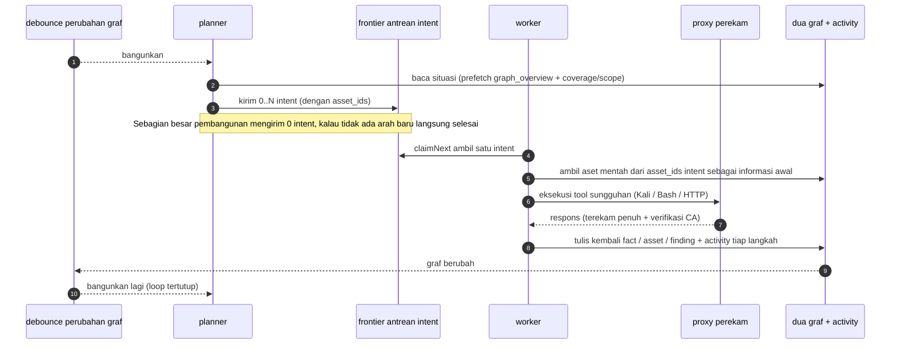
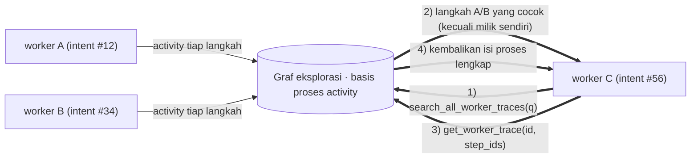
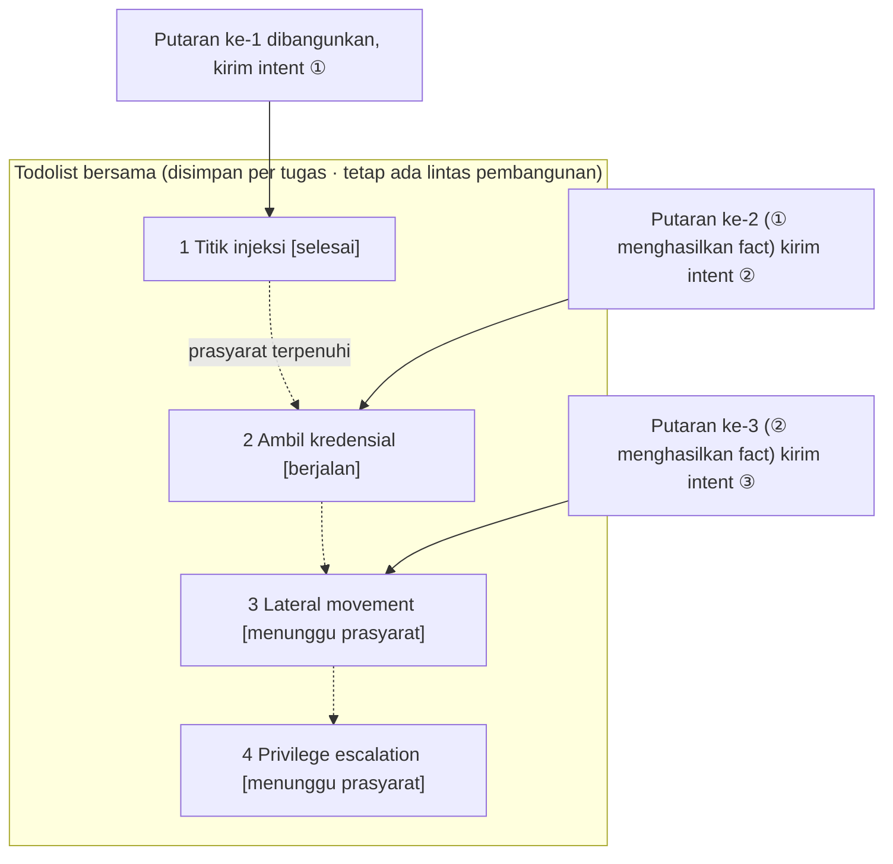

<div align="center">

# ARTEX

Sistem penetration testing otonom berbasis AI (backend Go + frontend Next.js)


🌐 **Demo online (data simulasi)**: [https://artex-demo.mhtsec.com](https://artex-demo.mhtsec.com)

📦 **Repositori ini adalah cadangan source code murni dari versi terakhir ARTEX. Sumber image Docker asli `autumn27/artex` sudah tidak berlaku, sekarang image dikelola sendiri oleh repositori ini sebagai `mianhuatang11/artex` (Docker Hub). Kalau gagal pull, jalankan `docker compose build` untuk build lokal dari source code murni, tanpa dependensi prebuilt dari luar.**

</div>

---

## Pratinjau Screenshot

> Interaksi lengkap bisa dilihat di [demo online](https://artex-demo.mhtsec.com) (frontend murni + data mock, tanpa backend).

| Dashboard (ringkasan / konsumsi token / aliran aktivitas) | Daftar tugas |
| :---: | :---: |
|  |  |

| Tugas · proses eksekusi (sesi / pemanggilan tool) | Jalur eksplorasi |
| :---: | :---: |
|  |  |

| Temuan | Aset |
| :---: | :---: |
|  |  |

| Peta cakupan aset (layout force-directed · sorotan yang sudah diuji · node bisa dilipat/dibuka) |
| :---: |
|  |

| Perekaman trafik | Percakapan human-in-the-loop |
| :---: | :---: |
|  |  |

| Manajemen agent | Konfigurasi LLM |
| :---: | :---: |
|  |  |

| Persetujuan intersepsi | Log backend |
| :---: | :---: |
|  |  |


---

## Detail Riwayat Persetujuan

"Riwayat persetujuan" global, "persetujuan intersepsi" di dalam tugas, dan kartu persetujuan di percakapan semuanya bisa dibuka untuk melihat detail. Struktur tampilannya mengacu pada
[komponen detail persetujuan milik AegisHook](https://github.com/RuoJi6/AegisHook/blob/main/web/src/components/CallDetail.vue), dengan tetap memakai komponen dan tema ARTEX:


## Sinkronisasi Aset (ScopeSentry)

Mendukung sinkronisasi data aset langsung dari [ScopeSentry](https://github.com/Autumn-27/ScopeSentry), jadi tidak perlu mengumpulkan ulang:

- Di halaman "**Sinkronisasi Aset**", isi alamat dan API Key ScopeSentry untuk menyambungkan sumber data;
- Pilih target dan jenis aset yang mau disinkronkan berdasarkan dimensi **proyek** atau **tugas** (domain / subdomain / IP / port / situs / endpoint...);
- Impor dengan satu klik, aset digabungkan sesuai cakupan aset perusahaan, lalu langsung masuk ke graf aset ARTEX untuk dieksplorasi agent.

---

## Instalasi

> Butuh database **PostgreSQL**; eksplorasi butuh konfigurasi **LLM** (`ANTHROPIC_API_KEY` atau `OPENAI_API_KEY`, bisa juga diatur di UI).

### Cara 1: Script instalasi satu klik (disarankan)

```bash
git clone https://github.com/mhtsec/ARTEX.git
cd ARTEX
./install.sh
```

Script ini akan: mendeteksi / otomatis memasang Docker → meminta kamu memilih **① Semua via Docker** atau **② Compile dan jalankan lokal**:

- **① Semua via Docker**: isi password Postgres (tekan Enter untuk acak) → otomatis menulis `.env` → `docker compose up -d`.
- **② Jalankan lokal**: pilih database (sambung ke yang sudah ada / jalankan satu via Docker) → membuat `config.json` → compile single binary dengan `go` (frontend tertanam) → jalankan.

Setelah terpasang, buka **http://localhost:8787** (kunjungan pertama ke `/setup` untuk mengatur password admin).

### Cara 2: Docker Compose (manual)

```bash
git clone https://github.com/mhtsec/ARTEX.git
cd ARTEX
cp .env.example .env          # isi POSTGRES_PASSWORD, opsional ANTHROPIC_API_KEY
docker compose up -d          # pull image mianhuatang11/artex + postgres
# → http://localhost:8787
```

> Sumber image asli `autumn27/artex` sudah dihapus dari Docker Hub, sekarang image dikelola sendiri oleh repositori ini sebagai **`mianhuatang11/artex`**.
> Kalau sumber image tidak tersedia (atau kamu mau mengubah kode sendiri), build lokal dari source code murni: `docker compose build && docker compose up -d`.
> Dockerfile memakai multi-stage build (static export frontend → static compile Go → image runtime), secara default memakai mirror dependensi yang ramah untuk jaringan Tiongkok, bisa ditimpa dengan `--build-arg GOPROXY=... / --build-arg NPM_REGISTRY=...`.

Image sudah berisi tool umum (ripgrep/curl/vim/npm/nmap...); `./skills` dan `./data` disimpan permanen lewat bind mount.

MCP remote bisa dipilih di pengaturan sistem sebagai `http` (Streamable HTTP) atau `sse` (SSE versi lama).
Layanan SSE versi lama biasanya memakai `GET /sse` untuk membuka event stream, lalu menerima request JSON-RPC lewat
`/message?sessionId=...` yang dikembalikan layanan; saat konfigurasi isi URL dengan `/sse`, dan header request diisi dengan format
`Authorization=Bearer <token>`.

### Cara 3: Unduh binary prebuilt (Releases)

Unduh zip sesuai platform dari [Releases](https://github.com/Autumn-27/ARTEX/releases) repositori asli (**repositori cadangan ini tidak menyimpan binary**, kalau Releases asli juga sudah tidak ada, pakai Cara 2 atau Cara 4). Setelah diekstrak, kamu akan mendapat `artex` + `start.sh` (di Windows `start.bat`) + `skills/` + `config.example.json`:

```bash
cp config.example.json config.json   # isi koneksi database
./start.sh                           # → http://localhost:8787
```

> Jalankan lewat `start.sh` / `start.bat`, jangan langsung `./artex`. Itu adalah script penjaga: setelah program keluar, script menentukan apakah perlu dijalankan ulang berdasarkan exit code. **[Pembaruan satu klik](#cara-1-pembaruan-satu-klik-dari-halaman-disarankan) di halaman bergantung pada script ini untuk mengganti binary.** Kalau menjalankan `./artex` langsung, program tidak akan dijalankan ulang setelah update.
> Agar tetap berjalan di background: `nohup ./start.sh >artex.log 2>&1 &`.

### Cara 4: Compile single binary dari source code

```bash
# 1) Static export frontend
cd web && npm ci && npm run build:static && cd ..
# 2) Salin ke direktori embed
cp -r web/out server/webui/dist
# 3) Compile (frontend hanya tertanam dengan -tags embedui)
CGO_ENABLED=0 go build -tags embedui -o artex ./cmd/artex
./start.sh
```

### Cara 5: Build paket zip Release lintas platform

`build.sh` akan build dan menanamkan frontend terlebih dahulu, lalu memakai Go linker untuk membuang informasi debug, dan mengompres file rilis menjadi zip. Mode Release secara default membuat paket zip untuk Linux amd64/arm64, macOS amd64/arm64, dan Windows amd64:

```bash
./build.sh --release
# Hasil: dist/artex-0.3.3-*.zip
```

Binary self-extracting UPX bisa tidak kompatibel dengan sebagian kernel Linux, lingkungan virtualisasi, atau kebijakan keamanan, jadi tidak diaktifkan secara default. Target bisa diatur dengan `ARTEX_TARGETS`; kalau sudah yakin lingkungan target kompatibel, tambahkan `--upx` secara eksplisit untuk memperkecil binary:

```bash
ARTEX_TARGETS=linux/amd64,windows/amd64 ./build.sh --release
./build.sh --target linux/amd64 --upx
```

---

## Pembaruan dan Upgrade

> Upgrade hanya mengganti program, data tidak disentuh: volume data Postgres `pgdata`, `./data` (jwt.key / SQLite, dll.), dan `./skills` tetap dipertahankan. **Migrasi database tidak perlu dijalankan manual**: setiap kali start, `artex` menjalankan ulang `schema.sql` secara idempoten (termasuk `ADD COLUMN` / `CREATE INDEX IF NOT EXISTS`), artinya "restart sama dengan migrasi". Sebelum upgrade tetap disarankan untuk backup `./data` dan database.

### Cara 1: Pembaruan satu klik dari halaman (disarankan)

Di kartu **Versi dan Pembaruan** pada halaman **Konfigurasi Sistem** (sidebar "Konfigurasi Sistem" → `/system/settings`), kamu bisa langsung mengecek dan memasang versi baru tanpa perlu login ke server.

Setelah klik "Perbarui": unduh paket rilis untuk platform saat ini → cocokkan dengan `SHA256SUMS` milik Release → smoke test binary baru dengan `-h` → simpan sementara sebagai `artex.new` → program keluar, lalu `start.sh` / `start.bat` menjalankannya ulang dan menyelesaikan penggantian. Halaman akan menunggu sampai versi baru aktif, lalu refresh otomatis.

- **Gagal tidak meninggalkan program rusak**: kalau verifikasi atau smoke test tidak lolos, file sementara dibuang dan versi saat ini tetap berjalan; kalau versi baru setelah penggantian gagal start 3 kali berturut-turut, sistem otomatis rollback ke `artex.old` (versi yang gagal disimpan sebagai `artex.failed` untuk diperiksa).
- **Bisa kembali kapan saja**: versi sebelumnya disimpan sebagai `artex.old`, dan di kartu ada tombol "Rollback ke versi sebelumnya". Perlu diingat, struktur database tidak ikut dikembalikan.
- **Pembaruan akan menghentikan tugas yang sedang berjalan**: pembaruan berarti restart, jadi lakukan saat sistem sedang tidak dipakai.
- **Build development tidak bisa diperbarui**: dinonaktifkan kalau nomor versinya `dev` atau hasil `git describe` dengan sufiks, supaya versi resmi tidak menimpa binary debug lokal.
- **Di Docker hanya program yang diganti, bukan image**: toolchain di dalam image seperti playwright / nmap tidak ikut di-upgrade, dan setelah `docker compose up -d` membuat ulang container, program akan kembali ke versi bawaan image. Kalau mau upgrade sekaligus dengan image, tetap pakai `docker compose pull artex && docker compose up -d artex`.
- Kalau akses ke GitHub butuh proxy, atur **proxy global** di halaman yang sama, dan jalur pembaruan akan lewat proxy itu. Pembaruan hanya mengunduh dari domain GitHub dan wajib HTTPS.

### Cara 2: Script pembaruan satu klik

```bash
cd ARTEX
./update.sh
```

Script ini opsional menjalankan `git pull` dulu untuk menarik kode terbaru, lalu meminta kamu memilih **① Update via Docker** atau **② Update dengan compile lokal** (sesuai dengan `install.sh`):

- **① Docker**: bisa menentukan tag image target (tekan Enter untuk memakai `ARTEX_TAG` di `.env`, default `latest`) → `docker compose pull` → `docker compose up -d` (restart dengan image baru langsung migrasi otomatis).
- **② Lokal**: build ulang hasil static frontend → compile ulang `./artex` (restart proses setelah selesai agar berlaku).

### Cara 3: Docker Compose (manual)

```bash
cd ARTEX
git pull                       # perbarui compose / script (opsional)
# Tentukan versi: set ARTEX_TAG=v0.2.0 di .env; kalau tidak diset, pakai latest
docker compose pull artex
docker compose up -d artex     # restart dengan image baru → migrasi schema otomatis
docker image prune -f          # bersihkan image lama (opsional)
```

### Cara 4: Binary prebuilt (Releases)

Unduh zip versi baru dari [Releases](https://github.com/Autumn-27/ARTEX/releases), hentikan proses lama, lalu timpa `artex` dan `skills/` (pertahankan `config.json` dan `data/` milikmu), kemudian restart:

```bash
cp -r <direktori_ekstrak>/skills ./ && cp <direktori_ekstrak>/artex ./
./start.sh
```

### Cara 5: Compile dari source code

```bash
git pull
cd web && npm ci && npm run build:static && cd ..
cp -r web/out server/webui/dist
CGO_ENABLED=0 go build -tags embedui -o artex ./cmd/artex
# Restart ./start.sh
```

---

## Konfigurasi

**Database** (`config.json`, atau timpa dengan environment variable `ARTEX_PG_DSN`):

```json
{
  "database": {
    "host": "127.0.0.1", "port": 5432,
    "user": "artex", "password": "yourpass",
    "dbname": "artex", "sslmode": "disable"
  }
}
```

**LLM**: `export ANTHROPIC_API_KEY=sk-...` (atau `OPENAI_API_KEY`), bisa juga diisi di halaman "Konfigurasi LLM" pada UI.
Opsional: `ARTEX_LLM_PROVIDER` / `ARTEX_LLM_MODEL` / `ARTEX_LLM_BASE_URL` / `ARTEX_LLM_PROXY`.

**Konkurensi**: jumlah work agent per tugas diatur di "Pengaturan Sistem" (default 3).

**Parameter umum**: `./start.sh -addr :8787 -proxy :8788` (`-addr` untuk frontend+API, `-proxy` untuk proxy perekaman trafik). Script start meneruskan parameter apa adanya ke `artex`.

### Deploy di balik reverse proxy (HTTPS / hanya membuka 443)

Frontend dan API/SSE dilayani dari satu port backend yang sama (default `:8787`), dan aliran aktivitas real-time secara default memakai alamat **same-origin**, jadi **tidak perlu mengatur `NEXT_PUBLIC_SSE_BASE`**. Cukup buka port 443 ke publik dan biarkan 8787 di jaringan internal.

SSE adalah koneksi panjang dengan push terus-menerus, jadi reverse proxy **wajib mematikan buffering**. Kalau tidak, browser bisa tersambung tapi tidak menerima event (gejalanya aliran aktivitas terus loading). Contoh Nginx:

```nginx
server {
    listen 443 ssl;
    server_name your.domain.com;
    # ssl_certificate / ssl_certificate_key ...

    location / {
        proxy_pass http://127.0.0.1:8787;
        proxy_set_header Host $host;
        proxy_set_header X-Forwarded-Proto $scheme;

        # Bagian penting untuk SSE: matikan buffering, timeout panjang, HTTP/1.1
        proxy_buffering off;
        proxy_cache off;
        proxy_read_timeout 3600s;
        proxy_http_version 1.1;
        proxy_set_header Connection "";
    }
}
```

> Hanya kalau SSE perlu lewat origin yang berbeda dari halaman (misalnya subdomain terpisah), atur `NEXT_PUBLIC_SSE_BASE` saat **build** (variabel ini dibekukan ke paket statis saat `next build`, mengaturnya saat container berjalan tidak berpengaruh).

---


## Pengembangan

### Uji ulang kerentanan secara manual

Tab "Uji Ulang" di detail tugas memungkinkan kamu memilih kerentanan dari tugas ini per halaman, melihat kesimpulan dan bukti dari tiap uji ulang sebelumnya, lalu memulai uji ulang secara manual. Setelah dimulai, tab saat ini tetap terbuka dan menampilkan ikon loading serta status "Sedang diuji ulang"; setelah perbaikan dikonfirmasi, status kerentanan ikut diperbarui.

Klik "Uji Ulang" di area aksi tiap baris daftar kerentanan, atau klik "Mulai Uji Ulang" di bagian "Uji Ulang Kerentanan" pada detail kerentanan, lalu isi versi perbaikan, kondisi pengujian, atau batasan (opsional). Sistem akan membuat sesi Agent uji ulang tersendiri, dan halaman saat ini tetap terbuka setelah dimulai. Tampilan datar, kelompok per tugas, dan tampilan aset pada daftar semuanya mendukung akses ini; saat uji ulang berjalan, tampil ikon loading dan status "Sedang diuji ulang", klik untuk masuk ke sesi terkait kalau ingin melihat, dan setelah selesai kembali menjadi "Uji Ulang". Uji ulang tidak perlu menjalankan ulang tugas scan aslinya. Kesimpulannya dibagi menjadi "Masih bisa direproduksi", "Sudah diperbaiki", dan "Tidak bisa dipastikan". Kesimpulan, bukti, dan tautan sesi dari setiap uji ulang disimpan di detail kerentanan.

Saat backend versi baru pertama kali dijalankan, sistem menyiapkan Agent "Uji Ulang Kerentanan" (`retester`) yang bisa diedit. Prompt, LLM, anggaran eksekusi, dan tool-nya bisa diatur di Manajemen Agent. Secara default memakai LLM yang terikat padanya, kalau belum diikat akan memakai konfigurasi aktif global. Kalau sesi uji ulang selesai dengan sukses dan kesimpulannya "Sudah diperbaiki", sistem otomatis mengubah status penanganan kerentanan menjadi "Sudah diperbaiki"; kalau masih berjalan, gagal, dihentikan, atau kesimpulannya lain, status asli dipertahankan. Bukti dan laporan asli selalu disimpan. Status "Sudah diperbaiki" juga bisa dipilih manual dari menu dropdown status. Kalau kerentanan yang sama sedang diuji ulang, sesi yang ada akan dipakai ulang; setelah dihentikan, gagal, atau layanan di-restart, uji ulang bisa dimulai lagi.

Di versi ini, riwayatnya dilihat lewat detail kerentanan dan sesi, belum dimasukkan ke ekspor laporan kerentanan atau paket arsip tugas, dan belum otomatis dikaitkan dengan paket trafik. Mode demo hanya membuat catatan simulasi yang diberi label jelas, tanpa mengirim request ke target sungguhan.

### Menjalankan dan menguji secara lokal

```bash
./dev.sh    # backend(:8787) + proxy trafik(:8788) + frontend next dev(:5173) → http://localhost:5173
```

- Backend: `go run ./cmd/artex` (tanpa `-tags embedui` frontend tidak ditanamkan)
- Frontend: `cd web && npm run dev` (`/api` di-proxy ke backend, dengan hot reload)
- Test: `go test ./...`
- Pratinjau mock (tanpa backend): `cd web && NEXT_PUBLIC_MOCK=1 npm run dev`
- Deploy ulang demo online (Cloudflare Pages, static export + data mock):
  ```bash
  cd web && NEXT_PUBLIC_MOCK=1 npm run build:static
  CLOUDFLARE_API_TOKEN=<token> npx wrangler pages deploy out --project-name=artex-demo --branch=main
  ```

---

## Arsitektur Teknis Sistem

ARTEX adalah **sistem penetration testing otonom yang digerakkan oleh multi-agent LLM**: backend monolit Go (dengan frontend Next.js tertanam) + PostgreSQL, dan kemampuan agent disediakan oleh SDK [`norma`](https://github.com/Autumn-27/norma) (`agentcore` / `tool` / `permission` / `harness` / `memory` / `transcript`). Intinya adalah **arsitektur dua graf**, beserta dua mekanisme otonomi di sekitarnya: **pertukaran informasi tingkat proses antar worker** dan **todolist bersama milik planner lintas putaran untuk menstabilkan rantai serangan**.

### Lapisan keseluruhan



| Lapisan | Tanggung jawab |
| --- | --- |
| **Frontend** | Static export Next.js, ditanam ke single binary lewat `go:embed`; visualisasi tugas/aset/jalur eksplorasi/peta cakupan, percakapan human-in-the-loop |
| **server** | Routing `net/http` + autentikasi JWT + SSE; `Manager` mengelola siklus hidup tugas, engine, dan DB store |
| **engine** | Setiap tugas punya satu `plannerLoop` + N goroutine worker; pengambilan intent, timeout/jeda/drain |
| **agent** | goals / planner / worker / mainagent, `ToolSet` mengekspos dua graf sebagai tool LLM |
| **db** | Penyimpanan dua graf di Postgres (pgx); schema ikut `go:embed` dan tabel dibuat secara idempoten setiap start |
| **Pendukung** | Proxy MITM perekam, gerbang persetujuan, pelengkapan asinkron, MCP/skill/memori/laporan |

### Arsitektur dua graf: graf eksplorasi + graf aset

Sistem memisahkan "**apa targetnya**" dan "**sejauh mana sudah diuji**" menjadi dua graf yang saling independen, tetapi terhubung lewat anchor:

- **Graf aset (Asset Graph, dibagi secara global)**: basis data kebenaran aset yang sama untuk semua tugas. Node-nya berupa `root_domain / subdomain / ip / service / app / endpoint`, dan dimiliki oleh perusahaan; relasi induk-anak domain→subdomain→layanan→endpoint dan key deduplikasi semuanya dihitung oleh program, agent hanya mengirim informasi mentah.
- **Graf eksplorasi (Exploration Graph, terpisah per tugas)**: proses "berpikir dan bergerak maju" dalam satu tugas. Node-nya berupa `goal (tujuan) / intent (niat) / fact (fakta) / finding (kerentanan) / hint (petunjuk)`, dihubungkan oleh edge seperti `spawns / derived_from / yields / proves` menjadi **rantai silsilah**, yang menjawab "arah mana diturunkan dari fakta apa, dan menghasilkan apa".
- **Dua graf terhubung lewat anchor**: `exploration_anchors(node_id, asset_id)` menambatkan intent/fact/finding ke aset tertentu. Dengan begitu, dari sebuah "arah eksplorasi" bisa dilihat aset mana yang diserang, dan dari "sebuah aset" bisa ditelusuri balik intent mana yang sudah mengujinya di tugas ini serta fakta apa yang sudah didapat. Ini juga menjadi dasar **tingkat cakupan pengujian aset** dan **peta cakupan aset** (aset dalam cakupan + sorotan yang sudah diuji).



> Pembagian kerja: **planner** membaca situasi graf eksplorasi, menilai tujuan, dan hanya mengirim **intent** ke frontier kalau ada arah baru yang belum tercakup; **worker** mengambil **satu intent**, mengeksekusinya dengan tool sungguhan, menulis aset/fakta/kerentanan baru kembali ke dua graf, lalu berhenti. Graf aset adalah fakta bersama, graf eksplorasi adalah rantai progres per tugas.

### Engine dan siklus hidup intent (satu putaran tertutup eksplorasi)

Engine adalah loop tertutup yang **digerakkan event**: begitu graf berubah, planner dibangunkan, planner mengirim intent, worker mengambil intent lalu mengeksekusi dan menulis hasilnya kembali, dan penulisan itu memicu putaran berikutnya, sampai tujuan terbukti (`prove_goal`).



### Pertukaran informasi tingkat proses antar worker

Dalam eksplorasi yang mendalam, banyak observasi berharga (sebuah error, potongan respons, parameter tersembunyi) muncul di **proses eksekusi** sebuah worker, tetapi belum tentu dicatat sebagai fact resmi. Untuk menghindari kerja berulang dan supaya worker di sepanjang rantai bisa saling memanfaatkan hasil satu sama lain, worker punya kemampuan **mencari proses lintas work**:

- `search_all_worker_traces(q)`: mencari berdasarkan kata kunci di **proses eksekusi work lain dalam tugas ini** (langkah dari intent milik sendiri otomatis dikecualikan), hasil yang cocok menyertakan `intent_id`;
- `list_worker_traces` / `get_worker_trace(intent_id, step_ids=[…])`: lihat dulu work apa saja yang sudah berjalan, lalu ambil isi lengkap beberapa langkah tertentu dari sebuah work untuk bertukar detail.

Dengan begini, meskipun belum ada fact terkait di graf eksplorasi, worker berikutnya tetap bisa memakai ulang observasi dari proses worker lain. **Informasi mengalir antar worker dengan granularitas "proses eksekusi"**, sementara batasnya tetap sama (setiap worker tetap hanya mengerjakan intent yang ia ambil).



### Todolist bersama planner lintas putaran → rantai serangan yang stabil

Rantai serangan nyata biasanya berupa **urutan multi-langkah yang saling bergantung** (misalnya: menemukan titik injeksi → mendapat kredensial → lateral movement → privilege escalation). Kalau semuanya dikirim paralel sekaligus, hasilnya kacau. Karena itu planner memegang **daftar tugas perencanaan (todolist) yang disimpan per tugas dan dibagi lintas pembangunan**:

- planner digerakkan event: begitu graf berubah, ia dibangunkan, tetapi **setiap pembangunan adalah sesi yang benar-benar baru**. Todolist bersama memungkinkannya **mencatat sekali** satu rantai eksploitasi berurutan, lalu **mengirim intent bertahap sesuai dependensi** di putaran-putaran berikutnya, bukan menjabarkan seluruh rantai di satu putaran;
- Di setiap putaran, intent hanya dikirim untuk langkah berikutnya yang "langkah prasyaratnya sudah selesai dan fact yang dibutuhkannya sudah ada", dan daftar diperbarui seiring progres (langkah yang sudah terpenuhi oleh fact ditandai selesai).



Dengan begitu, di lingkungan "digerakkan event + sesi tanpa state", rantai serangan tetap **maju dengan stabil, tidak berulang, dan tidak salah urutan**. Inilah kunci yang membuat ARTEX bisa menyelesaikan rantai eksploitasi multi-langkah secara otonom.

---

## Grup Diskusi

Pindai kode QR untuk mengikuti akun resmi WeChat **SecSentry**, lalu kirim pesan pribadi lewat akun tersebut untuk bergabung ke grup diskusi.

<div align="center">


</div>

---
## Referensi

https://github.com/oritera/Cairn


## Lisensi dan Penafian

### Lisensi open source

Proyek ini dilisensikan di bawah **GNU Affero General Public License v3.0 (AGPL-3.0)**, ketentuan lengkapnya ada di file [LICENSE](LICENSE) di root repositori.

Artinya siapa pun bebas memakai, memodifikasi, dan mendistribusikan proyek ini, tetapi **karya turunan juga wajib dibuka dengan AGPL-3.0**; khususnya, **kalau kamu memodifikasi proyek ini dan menyediakannya ke pengguna lewat jaringan (misalnya di-deploy sebagai layanan online), kamu juga wajib membuka source code lengkapnya kepada pengguna tersebut**.

> ⚠️ **Penting**: Lisensi open source itu sendiri tidak membatasi tujuan penggunaan software. "Batasan penggunaan" dan "Penafian" di bawah ini adalah kesepakatan tambahan dan pernyataan resmi dari penulis kepada pengguna, dan wajib dipatuhi.

**ARTEX hanya untuk belajar pribadi, riset kode, dan verifikasi teknis lokal, dan tidak boleh dipakai untuk melakukan pengujian sungguhan terhadap sistem atau situs online mana pun.**

### Cakupan penggunaan yang diizinkan

- Hanya boleh dipakai untuk **membaca, mempelajari, dan meneliti source code proyek ini**, serta memverifikasi prinsip teknis di **lingkungan lokal yang terisolasi**;
- Cocok untuk penggunaan non-serangan seperti belajar pribadi, riset akademik, dan review kode.

### Larangan

- **Dilarang keras memakai tool ini untuk melakukan scan, probing, eksploitasi, atau serangan terhadap situs, layanan online, atau sistem yang terhubung ke jaringan mana pun** (baik sudah mendapat izin atau belum, baik aset sendiri atau bukan);
- Dilarang keras memakai tool ini untuk penetration testing sungguhan, latihan serang-bertahan, atau lingkungan produksi apa pun;
- Dilarang keras memakai tool ini untuk intrusi ilegal, pencurian data, pemerasan, denial of service, atau aktivitas merusak maupun kriminal apa pun;
- Dilarang keras memakai tool ini untuk tindakan yang melanggar hukum dan peraturan di negara/wilayah tempat kamu berada.

### Tanggung jawab kepatuhan

Pengguna wajib mematuhi sendiri seluruh hukum dan peraturan di negara/wilayahnya terkait keamanan siber, perlindungan data, dan kejahatan komputer (di Tiongkok daratan termasuk tetapi tidak terbatas pada "Undang-Undang Keamanan Siber", "Undang-Undang Keamanan Data", "Undang-Undang Perlindungan Informasi Pribadi", beserta interpretasi yudisial terkait). **Segala tanggung jawab hukum dan konsekuensi yang timbul dari penggunaan tool ini sepenuhnya ditanggung oleh pengguna.**

### Penafian

Proyek ini disediakan "apa adanya (AS IS)", tanpa jaminan apa pun, baik tersurat maupun tersirat. Penulis dan kontributor tidak bertanggung jawab atas kerugian langsung maupun tidak langsung, kehilangan data, kerusakan sistem, atau sengketa hukum apa pun yang timbul dari penggunaan tool ini (baik cara penggunaannya tepat atau tidak). **Dengan mengunduh, memasang, atau memakai proyek ini, kamu dianggap sudah membaca, memahami, dan menyetujui seluruh ketentuan di atas.**
